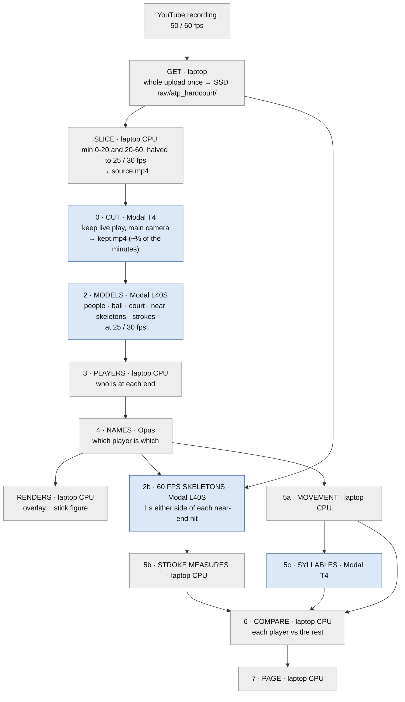

# atp_hardcourt pipeline

One match, from YouTube to the player comparison. 60 minutes per match, processed as two pieces: minutes 0-20
(`<match>`) and minutes 20-60 (`<match>_b`). Nothing is processed twice. No model ever runs on the laptop.

## Steps: where each runs

Code: [README](../README.md) has the package layout; `python -m dsa.batch atp_hardcourt` runs steps get to 2b.

| # | Step | What it does | Runs on | GPU | CPU / RAM | Frame rate |
|---|---|---|---|---|---|---|
| — | get | yt-dlp, whole upload, one download at a time, 90 s apart | laptop | — | laptop | native |
| — | slice | ffmpeg: the piece's minutes, H.264, halved fps | laptop | — | laptop (3 at a time) | 25 / 30 |
| 0 | cut | scene detection (CPU) + TennisCourtDetector on ~3 frames per shot; writes kept.mp4 | Modal | **T4** | 8 cores, 16 GB | 25 / 30 |
| 2 | models | RF-DETR (people, every frame), WASB (ball, every frame), TennisCourtDetector (every 10th frame), RTMW-x (near-end skeletons), F3ED (hits and stroke type) | Modal | **L40S** | 6 cores, 24 GB | 25 / 30 |
| 3 | players | tracking: who is at each end | laptop | — | laptop | 25 / 30 |
| 4 | names | Opus reads the scoreboard: which player is which | Opus API | — | — | — |
| — | renders | overlay and stick-figure videos (first 60 s) | laptop | — | laptop | 25 / 30 |
| 2b | 60 fps skeletons | RF-DETR + RTMW-x on the near player, ±1 s around each near-end hit; skipped for 30 fps uploads | Modal | **L40S** | 6 cores, 16 GB | 50 / 60 |
| 5a | movement | feet on court, per point | laptop | — | laptop | 25 / 30 |
| 5b | stroke measures | forehand, backhand, serve | laptop | — | laptop | 50 / 60 where there |
| 5c | syllables | keypoint-MoSeq fit | Modal | **T4** | default | 25 / 30 |
| 6 | compare | each player vs all others; camera, situation, AO / USO taken out | laptop | — | laptop | — |
| 7 | page | a profile per player | laptop | — | laptop | — |

At most 10 GPUs at once: up to 8 model runs (steps 2 and 2b) plus 2 cuts.

## Why these GPUs

Modal bills the GPU, the CPU cores ($0.047 per core-hour) and memory ($0.008 per GB-hour) separately, so a job's
price is all three.

| Step | Machine | $/hour, all in | Why |
|---|---|---|---|
| cut, syllables | T4 | ~1.10 | the GPU does little: a few hundred court frames, a small model fit |
| models, 60 fps skeletons | L40S, 6 cores, 24 GB | 2.43 | 60 s of kept video in 55 s, $0.037 per minute of play |

Measured on 60 s of kept video (Sinner–Zverev), after the fixes below:

| Machine | Time | $/hour | $ per minute of play |
|---|---|---|---|
| L40S, 6 cores, 24 GB | 55 s | 2.43 | **0.037** |
| L40S, 8 cores, 32 GB | 55 s | 2.58 | 0.039 |
| L40S, 4 cores, 16 GB | 65 s | 2.27 | 0.041 |
| L4, 8 cores, 32 GB, two runs side by side | 101 s each | 1.43 | 0.040 |
| L4, 8 cores, 32 GB | 122 s | 1.43 | 0.048 |

The people detector (RF-DETR at 1152 px, every frame) is limited by the GPU, so the faster GPU pays for itself.
Compiling it or feeding it frames already on the GPU made no difference.

Fixes behind these numbers (2026-10-04), each checked against the old output on the same 60 s:
- the skeleton model ran on the CPU: the Modal image's CPU onnxruntime (pulled in by rtmlib) shadowed the GPU one
  (dsa.gpu.volume.image); 19 → 151 skeletons a second
- the ball model in half precision, its inputs built in parallel and stacked on the GPU (heatmaps within 0.001)
- the next 64 frames' ball inputs and court checks are prepared on the CPU while the GPU works on these ones

## Why each frame rate

- **Strokes (F3ED) and ball (WASB):** 25 / 30 fps, the rate they were trained at.
- **Stroke measures:** 50 / 60 fps where the upload has it. On 19 forehands, the elbow angle at contact spread 52° at 30 fps against 21° at 60 fps; posture measures agreed (0.96-1.00).
- **Everything else** (tracking, movement, court): 25 / 30 fps.
